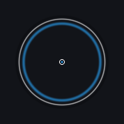
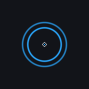
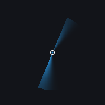

# Effect screenshots

[简体中文](screenshots.md)

v0.4.4, 2026-11-08. These are static frames from the actual `findmouse.exe` overlay
on an isolated solid backdrop, with no user desktop content. They show native rendering,
not the full animation.

| Ring | Heartbeat (default) |
|---|---|
|  |  |

| Sonar Ping | Orbit |
|---|---|
|  |  |

Heartbeat uses two phase-shifted rings and a center marker with a 1400 ms cycle.
Color, radius, follow timeout and fade remain configurable. New installs use Heartbeat;
upgrades preserve saved effect choices.

[简体中文](screenshots.md)
