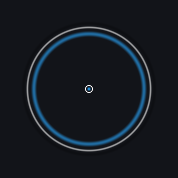
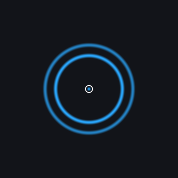
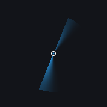

# 动效截图

[English](screenshots.en.md)

v0.4.4，2026-11-08。以下为实际 `findmouse.exe` 浮层的静态帧，使用独立纯色背板，
不包含用户桌面内容。它们展示原生渲染结果，不代表完整动画。

| 涟漪 | 心跳（默认） |
|---|---|
|  |  |

| 声呐 | 轨道 |
|---|---|
|  |  |

心跳使用两层错相圆环和中心定位点，周期 1400 ms。颜色、半径、跟随超时和淡出均可调整。
新安装默认使用心跳，升级保留已保存的效果选择。

[English](screenshots.en.md)
